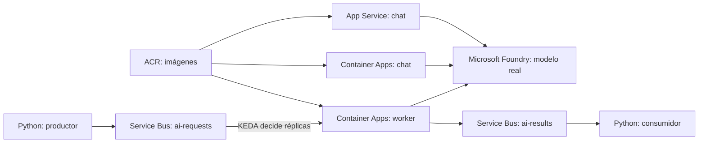

# Clase 2 — Laboratorios de hospedaje y orquestación de contenedores

Repositorio **con tres prácticas** sobre Azure App Service, Azure Container Apps y escalado basado en eventos mediante KEDA. Se reutiliza el concepto de Azure Container Registry de la Clase 1. El portal de Azure se usa para verificar el despliegue y las operaciones se realizan por CLI.

- El frontend (laboratorios 1 y 2) llama a un modelo implementado en Microsoft Foundry
- El worker (laboratorio 3) procesa mensajes reales de Azure Service Bus y genera respuestas reales. 

El laboratorio requiere una suscripción y un modelo implementado.

## Laboratorios

| Práctica | Servicio | Aplicación | Guía |
|---|---|---|---|
| 1 | Azure App Service | FastAPI + página de chat + Foundry; settings y Managed Identity | [01-app-service.md](labs/01-app-service.md) |
| 2 | Azure Container Apps | Misma web, revisiones v1/v2, tráfico 90/10 y rollback | [02-container-apps.md](labs/02-container-apps.md) |
| 3 | Container Apps + KEDA + Service Bus | Worker Python de IA, colas de entrada y salida, escalado 0–5 réplicas | [03-keda-servicebus.md](labs/03-keda-servicebus.md) |

## Arquitectura



## Requisitos

- Suscripción de Azure con permisos para crear recursos y asignar roles.
- Azure CLI reciente con la extensión `containerapp`
- Dado que usaremos `az acr build`, no se requiere Docker local.

> Importante: Los servicios **generan costos**: App Service Plan B1, Container Apps, ACR Basic, Service Bus Standard, llamadas a modelo y almacenamiento/logs. Comprueba cuotas y disponibilidad regional antes de iniciar. `az acr build` requiere que ACR Tasks esté habilitado para tu suscripción.

## Configuración inicial antes de las prácticas

Desde la raíz del repositorio, abre una terminal Bash y ejecuta estos comandos:

```bash
az login
cp .env.sh.example .env.sh
```

Crearemos un recurso de Microsoft Foundry en la región `eastus2`. Además, crearemos un proyecto asociado a ese recurso y, después, desplegaremos el modelo `gpt-4.1-mini`:

```bash
export LOCATION="eastus2"
export SUFFIX="$(date +%s)$RANDOM"
export RESOURCE_GROUP="rg-ai200-labs-${SUFFIX}"
export FOUNDRY_ACCOUNT="ai200-foundry-${SUFFIX}"
export FOUNDRY_PROJECT="ai200-project-${SUFFIX}"
export FOUNDRY_MODEL="gpt-4.1-mini"
export FOUNDRY_MODEL_VERSION="2025-04-14"

az group create --name "$RESOURCE_GROUP" --location "$LOCATION"

az cognitiveservices account create \
  --name "$FOUNDRY_ACCOUNT" \
  --resource-group "$RESOURCE_GROUP" \
  --location "$LOCATION" \
  --kind "AIServices" \
  --sku "S0" \
  --custom-domain "$FOUNDRY_ACCOUNT" \
  --assign-identity

az cognitiveservices account project create \
  --name "$FOUNDRY_ACCOUNT" \
  --resource-group "$RESOURCE_GROUP" \
  --project-name "$FOUNDRY_PROJECT" \
  --location "$LOCATION"

az cognitiveservices account deployment create \
  --name "$FOUNDRY_ACCOUNT" \
  --resource-group "$RESOURCE_GROUP" \
  --deployment-name "$FOUNDRY_MODEL" \
  --model-name "$FOUNDRY_MODEL" \
  --model-version "$FOUNDRY_MODEL_VERSION" \
  --model-format OpenAI \
  --sku-capacity 50 \
  --sku-name GlobalStandard
```

Una vez creado, obtén la información que necesitas para completar `.env.sh`:

```bash
az cognitiveservices account show -g "$RESOURCE_GROUP" -n "$FOUNDRY_ACCOUNT" \
  --query '{id:id, endpoint:properties.endpoint, kind:kind}' -o jsonc

az cognitiveservices account deployment list -g "$RESOURCE_GROUP" -n "$FOUNDRY_ACCOUNT" -o table
```

Edita el archivo .env.sh para completar la información mostrada a continuación:

- `# - LOCATION y SUFFIX (todo en minúsculas)`
- `# - FOUNDRY_OPENAI_BASE_URL: https://<recurso>.openai.azure.com/openai/v1/`
- `# - FOUNDRY_MODEL_DEPLOYMENT: nombre real del modelo implementado`
- `# - FOUNDRY_RESOURCE_ID: ARM ID del recurso que aloja el modelo`

Ejemplo de valores para el recurso recién creado:

```bash
export LOCATION="eastus2"
export FOUNDRY_OPENAI_BASE_URL="https://${FOUNDRY_ACCOUNT}.openai.azure.com/openai/v1/"
export FOUNDRY_MODEL_DEPLOYMENT="gpt-4.1-mini"
export FOUNDRY_RESOURCE_ID="/subscriptions/$(az account show --query id -o tsv)/resourceGroups/$RESOURCE_GROUP/providers/Microsoft.CognitiveServices/accounts/$FOUNDRY_ACCOUNT"
```

**Importante:** construye `FOUNDRY_OPENAI_BASE_URL` solo usando el endpoint OpenAI compatible v1 documentado para el recurso. En la variante estándar de Azure OpenAI, la URL suele ser `https://<recurso>.openai.azure.com/openai/v1/`. La región y el modelo deben soportar Responses API.

Guarda el archivo y ejecuta estos comandos para crear la infraestructura base de los laboratorios:

```bash
source .env.sh
./scripts/bootstrap.sh
```

Esto es lo que se hace paso a paso en el script `bootstrap.sh`:

- Carga variables desde `.env.sh`
- Valida la sesión de Azure
- Instala/actualiza la extensión `containerapp`
- Registra proveedores de recursos de Azure necesarios
- Crea el grupo de recursos y el ACR
- Crea una identidad administrada de usuario (UAI)
- Asigna permisos de lectura a ACR y acceso a Azure OpenAI/Foundry
- Compila la imagen del chat con `az acr build`
- Deja listo el contenedor para que luego se despliegue en App Service o Container Apps

## Ahora ya puedes ejecutar cada práctica

```bash
source .env.sh
./scripts/lab1.sh  # App Service, después: labs/01-app-service.md
./scripts/lab2.sh  # Container Apps, después: labs/02-container-apps.md
./scripts/lab3.sh  # KEDA y Service Bus, después: labs/03-keda-servicebus.md
```

> **Nota:** La práctica 3 depende del Environment de la 2, pero no depende del tráfico HTTP de la práctica 2. 

## Estructura del proyecto

```text
apps/chat/             FastAPI, frontend HTML, Dockerfile, requirements
apps/worker/           Worker Python + Service Bus + Foundry, Dockerfile
apps/client/           Enviar solicitudes, consumir resultados, requirements
labs/                  Tres guías extensas, con Azure CLI y portal de solo lectura
scripts/               Bootstrap, despliegues independientes y limpieza
.env.sh.example        Variables de entorno Bash (sin credenciales)
```

## Pruebas locales sin depender de un modelo

Puedes comprobar **rutas y validación** sin hacer una llamada al modelo. 

```bash
python3 -m venv .venv && source .venv/bin/activate
pip install -r apps/chat/requirements.txt
cd apps/chat && uvicorn main:app --host 127.0.0.1 --port 8000
```

Luego, desde otra terminal ejecuta este comando: 

```bash
curl http://localhost:8000/health
```

Si deseas consultar realmente el modelo en local necesitas autenticación con `az login` y variables del deployment configuradas. El modelo real se utiliza únicamente al llamar a `/api/chat`.

## Seguridad

- Acceso a ACR y modelo mediante **Managed Identity + Azure RBAC**, sin claves incrustadas.
- Para App Service puedes configurar variables y referencias seguras a **Azure Key Vault**. Las variables de modelo incluidas no son secretos (endpoint y deployment). 
- Nunca publiques `.env.sh`.
- En Container Apps se usa una **identidad asignada por usuario**. La variable `AZURE_CLIENT_ID` dirige `DefaultAzureCredential` a la identidad correcta.
- El worker reconoce cada mensaje **tras** publicar un resultado. 
  - Es un patrón *at least once*, no exactamente una vez
  - En producción, el consumidor debe ser idempotente por `id` y separar errores permanentes de transitorios. 
  - La cola de resultados es una demostración, no una base de datos de producción.
- El frontend de ejemplo es un laboratorio público sin autenticación de usuarios finales; **no** es una configuración adecuada para internet abierto de producción. 
  - En producción, debes aplicar identidad y autorización, cuotas, rate limiting y controles de contenido antes de exponerlo.

## Costos y limpieza

Al terminar **TODOS** los laboratorios:

```bash
source .env.sh
./scripts/cleanup.sh
```

Este comando elimina **todo el grupo de recursos de prácticas**. Se solicita confirmación manual.

## Fuentes oficiales

- [Azure App Service custom container](https://learn.microsoft.com/en-us/azure/app-service/configure-custom-container)
- [Azure Container Apps: revisions](https://learn.microsoft.com/en-us/azure/container-apps/revisions)
- [Azure Container Apps: traffic splitting](https://learn.microsoft.com/en-us/azure/container-apps/traffic-splitting)
- [Azure Container Apps: scale rules](https://learn.microsoft.com/en-us/azure/container-apps/scale-app)
- [Microsoft Foundry / Azure OpenAI v1 API](https://learn.microsoft.com/en-us/azure/foundry/openai/api-version-lifecycle)
- [Microsoft Learn — Keyless Azure OpenAI](https://learn.microsoft.com/en-us/azure/developer/ai/get-started-azure-openai-starter-kit)
